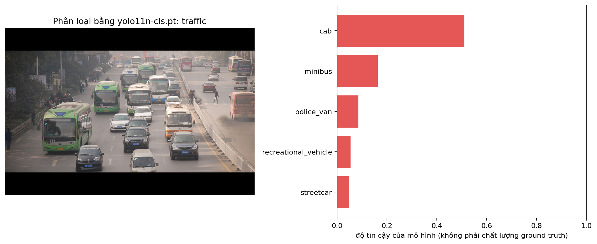
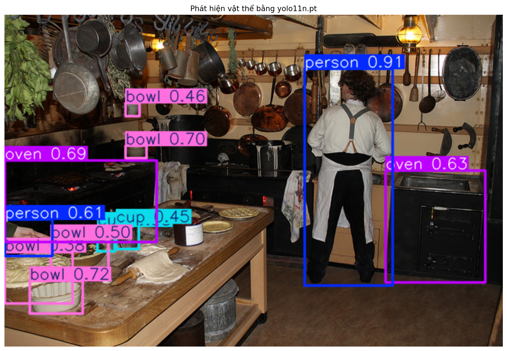
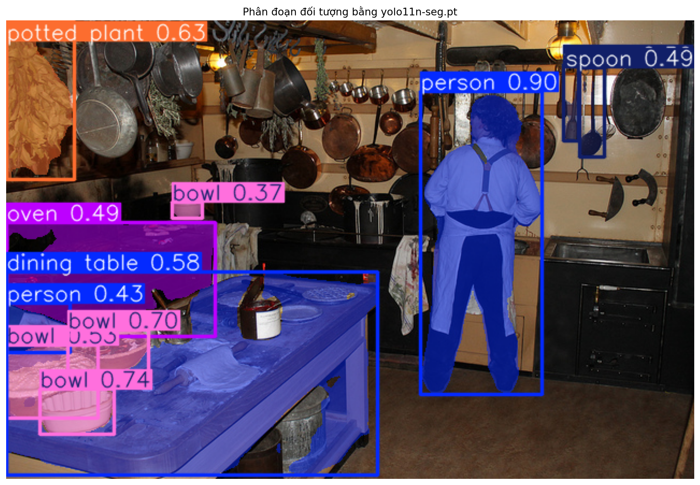

# Báo cáo bài thực hành Ngày 1 – Đọc prediction YOLO11 để hiểu định dạng nhãn

**Ngày chạy:** 06/11/2026
**Runtime Colab:** GPU T4
**Python / PyTorch / Ultralytics:** Python 
**Checkpoint:** `yolo11n-cls.pt`, `yolo11n.pt`, `yolo11n-seg.pt`.  
**Ngưỡng detection/segmentation dùng khi tạo JSON:** `0.35`, theo trường `score_threshold`.  
**Thay đổi so với notebook nguồn:**  Không / mô tả rõ thay đổi
Cách dùng mẫu này: copy/điền trên máy, lưu thành REPORT.md, rồi upload vào panel Files của Colab (notebook không tự tạo file này). Ô cuối Colab sẽ đóng ZIP cùng day1_lab_outputs/. Giải nén và đưa vào report/ trên GitHub, rồi nộp link repo trên LMS. Không ghi họ tên, MSSV, email, số điện thoại hoặc dữ liệu cá nhân khác vào báo cáo/output; họ tên/MSSV chỉ nằm trong tên repository.

## Từ cần nhớ

| Từ | Nghĩa ngắn |
| --- | --- |
| Prediction | Kết quả model dự đoán; chưa phải nhãn đúng |
| Ground truth | Nhãn do người gán và kiểm tra theo quy tắc |
| Taxonomy | Bộ tên lớp và mã lớp, ví dụ ImageNet-1K hoặc COCO-80 |
| Checkpoint | File model đã huấn luyện sẵn |
| Guideline | Quy tắc gán nhãn được thống nhất cho bài toán |
| Annotator | Người gán nhãn |
| Reviewer / QC | Người kiểm tra nhãn và yêu cầu sửa khi cần |
| Escalation | Chuyển ca khó cho Lab Coach hoặc người có trách nhiệm quyết định |
| Model score | Điểm của model cho dự đoán; không phải điểm chất lượng nhãn người |

## 1. Phân loại ảnh

Nguồn: [classification_predictions.json](day1_lab_outputs/classification_predictions.json), chỉ dùng `sample_id = traffic`, `rank = 1).

**Câu 1. Chép record hạng 1 gồm class_id, class_name, rank, score và taxonomy_name.**

Các trường được yêu cầu trong record:

```json
{
  "class_id": 468,
  "class_name": "cab",
  "rank": 1,
  "score": 0.510915,
  "taxonomy_name": "ImageNet-1K"
}
```

**Câu 2. Record này nói về cả bức ảnh hay về một vật thể riêng trong ảnh? Vì sao?**

Record nói về **cả bức ảnh**. Model phân loại nhận ảnh `traffic` và xếp hạng các lớp cho ảnh đó. Record không có tọa độ hoặc box chỉ ra một chiếc xe riêng biệt. Vì vậy, lớp `cab` là dự đoán ở cấp ảnh, không xác định chiếc xe cụ thể nào trong ảnh là taxi.

**Câu 3. Danh sách tên lớp do đâu mà có: model tự nghĩ ra hay đi kèm taxonomy/checkpoint?**

Danh sách lớp đi kèm taxonomy/checkpoint đã huấn luyện. Ở đây, `yolo11n-cls.pt` dùng `ImageNet-1K`, được ghi trong JSON. Model tính điểm cho các lớp có sẵn, rồi ánh xạ mã lớp sang tên lớp; model không tự đặt tên lớp mới cho từng ảnh.

**Câu 4. Vì sao cần ghi cả class_id, class_name và taxonomy_name, không chỉ ghi mỗi tên lớp?**

`class_id` giúp phần mềm tham chiếu mã lớp; `class_name` giúp người đọc hiểu nhãn; `taxonomy_name` cho biết bộ lớp mà mã và tên đó thuộc về. Một mã chỉ có ý nghĩa trong bộ lớp tương ứng. Ghi đủ ba trường giúp tránh nhầm giữa các taxonomy và kiểm tra được việc ánh xạ mã sang tên, chẳng hạn `468 → cab` trong output ImageNet-1K này.

**Câu 5. Nếu trong ảnh có nhiều vật hoặc nhiều chủ đề, guideline cần nói rõ điều gì để người gán nhãn chọn một lớp?**

Guideline cần quy định nhãn đại diện cho đối tượng chính, hoạt động hay bối cảnh của ảnh; đồng thời đưa ra tiêu chí ưu tiên và cách xử lý khi nhiều chủ thể nổi bật ngang nhau. Ví dụ, nếu bài toán chọn đối tượng chính, guideline phải nói rõ ưu tiên theo diện tích nhìn thấy, vị trí hay trọng tâm nội dung, kèm ví dụ và cách xử lý trường hợp hòa. Với ảnh `traffic` có nhiều xe, annotator phải dùng cùng một quy tắc chọn lớp, không tự chọn xe mình chú ý trước hoặc lấy lớp có score cao nhất làm nhãn.

**Câu 6. Vì sao không được lấy score của model làm ground truth?**

`score = 0.510915` chỉ là điểm model gán cho dự đoán `cab`. Model có thể nhận sai lớp hoặc chọn một đặc điểm không phù hợp với quy tắc gán nhãn của bài toán. Ground truth phải được xác định từ ảnh theo guideline và được kiểm tra chất lượng; score không thay thế được quá trình này và không phải thước đo chất lượng nhãn do người gán.



*Hình 1. Ảnh traffic có nhiều phương tiện; cab đứng đầu trong năm dự đoán của model.*

## 2. Phát hiện vật thể

Nguồn: [detection_predictions.json](day1_lab_outputs/detection_predictions.json), chỉ dùng `sample_id = kitchen`.

**Câu 1. Chép một record gồm class_name, score, bbox_xyxy, bbox_width và bbox_height.**

Em chọn record của người đứng ở phía bên phải ảnh:

```json
{
  "class_name": "person",
  "score": 0.912625,
  "bbox_xyxy": [385.33, 69.24, 498.92, 348.92],
  "bbox_width": 113.58,
  "bbox_height": 279.68
}
```

**Câu 2. Giải thích box bằng lời thường: góc trên-trái ở đâu, góc dưới-phải ở đâu, rộng/cao bao nhiêu pixel?**

Ảnh gốc có kích thước `640 × 427` pixel. Gốc tọa độ ở góc trên-trái ảnh; x tăng sang phải, y tăng xuống dưới.

Góc trên-trái box nằm tại `(385.33, 69.24)`; góc dưới-phải nằm tại `(498.92, 348.92)`. Theo các trường kích thước trong JSON, box rộng `113.58` pixel và cao `279.68` pixel. Box bao quanh người đứng bên phải, từ vùng đầu đến chân.

Nếu lấy các tọa độ đã xuất để trừ, chiều rộng là `498.92 − 385.33 = 113.59` pixel, lệch `0.01` pixel so với `bbox_width`. Chênh lệch nhỏ này phù hợp với việc các trường được làm tròn khi xuất; báo cáo giữ nguyên giá trị của JSON.

**Câu 3. Chọn hai ngưỡng. Mỗi ngưỡng có bao nhiêu prediction?**

Em chọn `0.35` và `0.60`:

| Ngưỡng score | Số prediction của kitchen | Cách xác định |
| --- | ---: | --- |
| 0.35 | 11 | Đếm record kitchen trong JSON; các record ghi score_threshold = 0.35 |
| 0.60 | 6 | Lọc 11 record đã lưu, giữ các record có score từ 0.60 trở lên |

Năm record bị loại khi lọc từ `0.35` lên `0.60` gồm ba `bowl` và hai `cup`. Đây là phép đếm/lọc trên JSON đã lưu, chưa phải kết quả được chép từ ô so sánh ngưỡng trong notebook. Cần đối chiếu ô đó trước khi nộp. Không thể suy ra số prediction ở ngưỡng `0.20` từ tệp này vì các prediction dưới `0.35` không được lưu.

**Câu 4. Khi hạ ngưỡng, người reviewer phải làm thêm việc gì?**

Reviewer phải kiểm tra thêm các prediction có score thấp được giữ lại: xem có vật thể thật hay không, class có đúng không, box có bám sát vật thể không, và có box trùng với một vật thể đã được gán hay không. Reviewer cũng cần đối chiếu ảnh để phát hiện vật thể bị bỏ sót, rồi yêu cầu annotator sửa các nhãn không đạt guideline. Trong ví dụ lọc JSON này, chuyển từ `0.60` xuống `0.35` làm số record cần xem tăng từ 6 lên 11.

**Câu 5. Viết một quy tắc box để người gán nhãn làm theo, áp dụng được cho nhiều ảnh.**

**Quy tắc đề xuất:** Với một vật thể đủ điều kiện gán nhãn, vẽ box song song với cạnh ảnh, ôm sát các điểm ngoài cùng của phần vật thể nhìn thấy; không nới box để bao thêm vật thể khác và không tự mở rộng đến phần bị che hoặc nằm ngoài ảnh. Lưu tọa độ theo pixel của ảnh gốc dưới dạng `[x_min, y_min, x_max, y_max]`.

Quy tắc này dùng phạm vi nhìn thấy. Guideline chính thức cần thống nhất phạm vi đó trước khi áp dụng cho cả bộ dữ liệu.

**Câu 6. Trên ảnh kitchen, chỉ ra một vật bị che khuất hoặc cắt mép. Bạn sẽ viết thành quy tắc trong guideline hay đưa lên hỏi Lab Coach? Vì sao?**

Ở mép trái ảnh có một phần cánh tay/bàn tay của người bị cắt bởi khung ảnh. JSON có prediction `person`, score `0.610931`, box `[0.12, 263.18, 61.55, 310.78]`; đây là vị trí cần reviewer xem lại.

Em chọn **escalation đến Lab Coach** trước khi quyết định gán nhãn chính thức cho ca này. Lý do là phải thống nhất liệu chỉ một phần cơ thể như vậy có đủ điều kiện gán lớp `person` hay không và giới hạn box ra sao. Sau khi được quyết định, đưa ca này thành ví dụ trong guideline để các annotator xử lý nhất quán.



*Hình 2. Box person lớn ở bên phải và prediction person bị cắt ở mép trái là hai record khác nhau.*

## 3. Phân đoạn theo từng đối tượng

Nguồn: [segmentation_predictions.json](day1_lab_outputs/segmentation_predictions.json), chỉ dùng `sample_id = kitchen`.

**Câu 1. Chép một record gồm instance_id, class_name, score, số điểm polygon và 3–5 điểm đầu của polygon_xy.**

Các trường được yêu cầu của record đã chọn:

```json
{
  "instance_id": "kitchen-001",
  "class_name": "person",
  "score": 0.899318,
  "polygon_point_count": 348
}
```

Năm điểm đầu của `polygon_xy`, theo thứ tự trong JSON và đơn vị pixel:

```json
[[446.0, 70.0], [445.0, 71.0], [444.0, 71.0], [443.0, 72.0], [442.0, 72.0]]
```

**Câu 2. So với box, polygon cho thêm thông tin gì về hình dạng vật thể?**

Box chỉ mô tả một vùng chữ nhật bao quanh vật thể, có thể chứa cả nền bên trong. Polygon mô tả đường biên chi tiết hơn, ví dụ theo đầu, vai, tay và chân của người trong record `kitchen-001`. Nhờ đó, nhãn có thể phân biệt vùng thuộc vật thể với nền trong cùng box và thể hiện hình dạng không phải hình chữ nhật.

**Câu 3. instance_id dùng để làm gì? Nó không phải class ID và không phải tracking ID nghĩa là gì?**

`instance_id` dùng để phân biệt từng đối tượng riêng trong output của ảnh. Chẳng hạn `kitchen-001` và `kitchen-009` là hai instance khác nhau, nhưng cả hai đều có `class_id = 0`, `class_name = person`.

`class_id` cho biết loại đối tượng, nên nhiều người có thể chung một class ID. Tracking ID dùng để liên kết cùng một đối tượng qua nhiều khung hình; các mã instance trong output này không cung cấp liên kết thời gian đó và không bảo đảm giữ nguyên khi chạy lại model.

**Câu 4. Viết một quy tắc vẽ biên mask để người gán nhãn làm theo.**

**Quy tắc đề xuất:** Gán mask riêng cho từng instance, bám theo ranh giới phần nhìn thấy của đúng vật thể; loại nền và phần thuộc vật thể che phía trước khỏi mask, không tự điền phần bị che. Với polygon, đặt điểm theo các chỗ đổi hướng của biên và tránh đường biên tự cắt. Khi không xác định được biên theo guideline, đánh dấu ca cần review hoặc escalation.

**Câu 5. Trên ảnh kitchen, chỉ ra một chỗ biên mờ, hai vật chạm nhau hoặc bị che. Bạn dùng guideline hay escalation? Vì sao?**

Bát màu trắng ở tiền cảnh, gần góc dưới bên trái, che một phần mặt bàn. JSON có instance `kitchen-002` là `bowl` và `kitchen-005` là `dining table`; hai mask cần được kiểm tra ở vùng tiếp giáp này.

Em chọn **áp dụng guideline về phần nhìn thấy đã đề xuất ở câu 4**: mask bàn dừng ở biên của bát, không tô lên bát và không đoán vùng mặt bàn nằm phía dưới bát; bát được giữ thành instance riêng. Đây là quan hệ che khuất quan sát được trên ảnh nên quy tắc có thể áp dụng nhất quán. Nếu có đoạn biên thực sự không nhìn rõ, chuyển riêng đoạn đó cho reviewer/Lab Coach xem xét.



*Hình 3. Kiểm tra biên mask theo từng instance, đặc biệt ở vùng bát che mặt bàn.*

## 4. Vòng đời và kiểm tra chất lượng

Chuỗi khái niệm của production:

`ảnh thô → guideline → ground truth → huấn luyện → prediction → QC/rework`

Guideline xác định nhãn cần tạo và cách xử lý ca khó. Annotator gán nhãn theo guideline; reviewer kiểm tra để có ground truth đủ chất lượng cho huấn luyện. Sau khi model tạo prediction, QC đối chiếu ảnh và quy tắc để xác định lỗi cần sửa. Bài lab này chỉ đọc prediction; các record JSON đang dùng chưa phải ground truth.

| Tác vụ | Ground truth trông như thế nào? Đơn vị nhãn | Lỗi hoặc chỗ khó quyết định thấy trên ảnh/JSON | Annotator làm gì? | Reviewer xem gì? |
| --- | --- | --- | --- | --- |
| Phân loại ảnh | Một lớp cho cả ảnh theo taxonomy và quy tắc chọn chủ thể/chủ đề chính | Ảnh traffic có nhiều xe nhưng rank 1 là cab, score 0.510915; cần quy tắc để chọn một nhãn đại diện | Chọn lớp theo guideline, ghi đúng mã và tên lớp; chuyển ca không quyết định được | Kiểm tra lớp phù hợp ảnh và tiêu chí chọn nhãn; đối chiếu mã lớp với taxonomy |
| Phát hiện vật thể | Một class và một bbox cho mỗi vật thể đủ điều kiện | Trong kitchen, prediction person ở mép trái chỉ bao quanh phần cơ thể bị cắt, score 0.610931; chưa rõ điều kiện gán người bị cắt | Gán box sát phạm vi được quy định; hỏi Lab Coach về điều kiện gán phần cơ thể bị cắt | Kiểm tra vật bị thiếu/đếm trùng, sai lớp, box lệch và cách xử lý vật bị cắt |
| Instance segmentation | Một class và mask/polygon cho từng instance riêng | Bowl kitchen-002 che một phần dining table kitchen-005; phải phân biệt biên của từng vật | Vẽ mask từng vật theo phần nhìn thấy, tách bát khỏi bàn và không đoán phần khuất | Kiểm tra biên, vùng nền bị lấy nhầm, phần vật bị mất và việc tách các instance |

## 5. An toàn dữ liệu

**Câu 1. Quy tắc bảo vệ dữ liệu của bạn cho bài lab này là gì? Viết một câu.**

Chỉ sử dụng ảnh được phép trong phạm vi bài lab, giữ thông tin nguồn và giấy phép, đồng thời không đưa họ tên, MSSV, email, số điện thoại hay dữ liệu nhạy cảm của người nộp vào báo cáo/output.

**Câu 2. Nếu gặp ảnh hoặc dữ liệu không đúng phạm vi, bạn sẽ dừng và báo cho ai?**

Em dừng xử lý và không đưa dữ liệu đó vào output hoặc repository, sau đó báo Lab Coach/giảng viên phụ trách để xác nhận phạm vi và hướng dẫn xử lý.

## 6. Checklist trước khi nộp link repo

Các mục tệp dưới đây đã có trong thư mục cục bộ. Khi đưa lên GitHub, cần kiểm tra lại đúng cấu trúc `report/`:

- [x] `REPORT.md` đã trả lời các câu hỏi
- [x] `day1_lab_outputs/classification_predictions.json`
- [x] `day1_lab_outputs/detection_predictions.json`
- [x] `day1_lab_outputs/segmentation_predictions.json`
- [x] `day1_lab_outputs/IMAGE_ATTRIBUTION.md`
- [x] `day1_lab_outputs/visuals/classification_top5.png`
- [x] `day1_lab_outputs/visuals/detection_predictions.png`
- [x] `day1_lab_outputs/visuals/segmentation_prediction.png`
- [ ] Ô validation cuối notebook báo `PASS` — cần xác nhận từ notebook
- [x] Không ghi họ tên, MSSV hoặc dữ liệu nhạy cảm của người nộp trong báo cáo/output
- [ ] Đã nộp **link repository** trên LMS

Thông tin tác giả ảnh nguồn và giấy phép được giữ trong [IMAGE_ATTRIBUTION.md](day1_lab_outputs/IMAGE_ATTRIBUTION.md).

